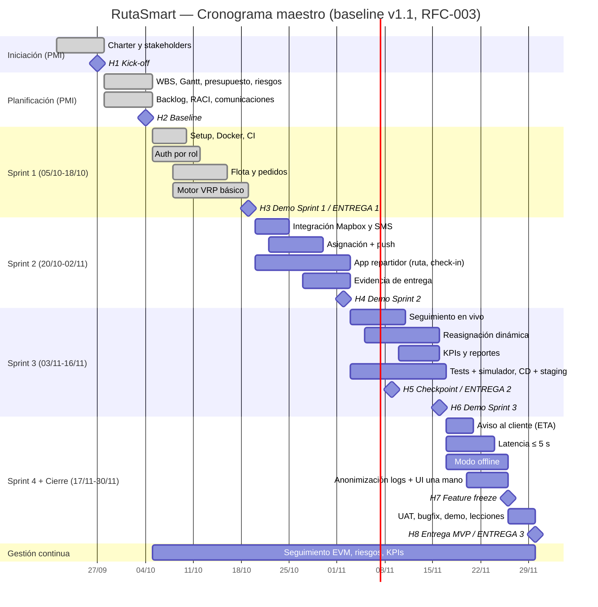

# WBS y Cronograma — RutaSmart (P05)

> Versión 1.1 · Baseline H2, replanificada el 19/10/2026 (RFC-003) · Responsable: Miembro 1 (PM)
> Capacidad: 6 personas × 6 h/semana × 10 semanas = **360 horas**

---

## 1. Calendario del proyecto

| Semana | Fechas | Fase | Hito / Entrega |
| --- | --- | --- | --- |
| S1 | 21/09 – 27/09 | Iniciación (PMI) | H1 Kick-off (27/09) |
| S2 | 28/09 – 04/10 | Planificación (PMI) | H2 Baseline (04/10) |
| S3 | 05/10 – 11/10 | Sprint 1 | |
| S4 | 12/10 – 18/10 | Sprint 1 | H3 Demo Sprint 1 (18/10) · **ENTREGA 1 (19/10)** |
| S5 | 19/10 – 25/10 | Sprint 2 (desde el 20/10) | |
| S6 | 26/10 – 01/11 | Sprint 2 | H4 Demo Sprint 2 (02/11) |
| S7 | 02/11 – 08/11 | Sprint 3 (desde el 03/11) | |
| S8 | 09/11 – 15/11 | Sprint 3 | H5 Checkpoint · **ENTREGA 2 (09/11)** |
| S9 | 16/11 – 22/11 | Sprint 4 (desde el 17/11) | H6 Demo Sprint 3 (16/11) |
| S10 | 23/11 – 30/11 | Sprint 4 + Cierre (PMI) | H7 Feature freeze (26/11) · H8 MVP · **ENTREGA 3 (30/11)** |

> El calendario de referencia era de 11 semanas; el 19/10/2026 se ajustó a 10 (RFC-003).

--- | --- | --- | --- |
| S1 | 21/09 – 27/09 | Iniciación (PMI) | H1 Kick-off (27/09) |
| S2 | 28/09 – 04/10 | Planificación (PMI) | H2 Baseline (04/10) |
| S3 | 05/10 – 11/10 | Sprint 1 | |
| S4 | 12/10 – 18/10 | Sprint 1 | H3 Demo Sprint 1 (18/10) · **ENTREGA 1 (19/10)** |
| S5 | 19/10 – 25/10 | Sprint 2 | |
| S6 | 26/10 – 01/11 | Sprint 2 | H4 Demo Sprint 2 (01/11) |
| S7 | 02/11 – 08/11 | Sprint 3 | |
| S8 | 09/11 – 15/11 | Sprint 3 | H5 Checkpoint (15/11) · **ENTREGA 2 (~16/11)** |
| S9 | 16/11 – 22/11 | Sprint 4 | |
| S10 | 23/11 – 29/11 | Sprint 4 | H6 Demo Sprint 4 (29/11) |
| S11 | 30/11 – 06/12 | Sprint 5 + Cierre (PMI) | H7 Feature freeze (03/12) · H8 MVP (06/12) · **ENTREGA 3 (~07/12)** |

---

## 2. WBS (Estructura de Desglose del Trabajo)

```text
RutaSmart (360 h)
├── 1. Gestión del proyecto ............................ 56 h
│   ├── 1.1 Iniciación: Charter, stakeholders, kick-off
│   ├── 1.2 Planificación: WBS, Gantt, presupuesto, riesgos, RACI, comunicaciones, backlog
│   ├── 1.3 Seguimiento y control: EVM mensual, KPIs, riesgos, RFC/CCB
│   ├── 1.4 Ceremonias Scrum: planning, daily, review, retro
│   └── 1.5 Cierre: lecciones aprendidas, acta de cierre, defensa
├── 2. Análisis y diseño ................................ 30 h
│   ├── 2.1 Historias de usuario y criterios de aceptación
│   ├── 2.2 Arquitectura del sistema
│   ├── 2.3 Modelo de datos (PostgreSQL + PostGIS)
│   └── 2.4 Mockups UX/UI (panel web y app repartidor)
├── 3. Plataforma y DevOps .............................. 26 h
│   ├── 3.1 Repositorio, estructura y Docker
│   ├── 3.2 Pipeline CI (lint, build, tests)
│   ├── 3.3 CD y entornos dev / staging / prod
│   └── 3.4 Monitoreo y dashboard DORA
├── 4. Backend (FastAPI) ............................... 90 h
│   ├── 4.1 Autenticación y roles (JWT)
│   ├── 4.2 Gestión de flota, conductores y vehículos
│   ├── 4.3 Pedidos y geocodificación
│   ├── 4.4 Motor de optimización VRP (OR-Tools)
│   ├── 4.5 Asignación de rutas y notificaciones push
│   ├── 4.6 Tracking en tiempo real (WebSocket)
│   ├── 4.7 Reasignación dinámica
│   ├── 4.8 KPIs y reportes
│   ├── 4.9 Notificación al cliente final (ETA + enlace)
│   └── 4.10 Anonimización de datos en logs
├── 5. Frontend – Panel web (React) .................... 52 h
│   ├── 5.1 Login y navegación por rol
│   ├── 5.2 Gestión de flota y pedidos (incl. importación CSV)
│   ├── 5.3 Visualización de rutas en mapa
│   ├── 5.4 Seguimiento en vivo
│   ├── 5.5 Dashboard de KPIs
│   └── 5.6 Página pública de tracking para el cliente
├── 6. App repartidor (PWA) ............................ 48 h
│   ├── 6.1 Ruta del día y navegación
│   ├── 6.2 Check-in por parada
│   ├── 6.3 Evidencia de entrega (firma, foto, observaciones)
│   ├── 6.4 Modo offline y sincronización
│   └── 6.5 UI para uso con una mano / guantes
├── 7. Integraciones ..................................... 12 h
│   ├── 7.1 Mapbox (mapas, geocoding, directions)
│   └── 7.2 Proveedor SMS / email
├── 8. Calidad y testing ................................. 32 h
│   ├── 8.1 Tests unitarios e integración
│   ├── 8.2 Simulador de rutas con datos sintéticos
│   ├── 8.3 Pruebas de latencia ≤ 5 s (carga de 200 rutas: fuera del compromiso)
│   ├── 8.4 Pruebas E2E
│   └── 8.5 Prueba de uso guiada con ≥ 3 personas ajenas al equipo
└── 9. Documentación ..................................... 14 h
    ├── 9.1 README, arquitectura y API (OpenAPI)
    ├── 9.2 Documentación del algoritmo (versión inicial; RF20 completo fuera del compromiso)
    └── 9.3 Manual de usuario y demo grabada
```

### Diccionario de la WBS (resumen)

| Código | Paquete | Entregable | Responsable | Horas | Semanas |
| --- | --- | --- | --- | --- | --- |
| 1 | Gestión del proyecto | Charter, baseline, reportes EVM, retros, acta de cierre | M1 | 56 | S1–S10 |
| 2 | Análisis y diseño | Backlog, arquitectura, modelo de datos, mockups | M2 | 30 | S1–S4 |
| 3 | Plataforma y DevOps | Repo, CI/CD, entornos, dashboard DORA | M6 | 26 | S3–S10 |
| 4 | Backend | API REST + WebSocket, motor VRP | M4 / M5 | 90 | S3–S10 |
| 5 | Frontend panel web | Panel de admin y despachador | M3 | 52 | S3–S10 |
| 6 | App repartidor | PWA del conductor | M6 | 48 | S5–S10 |
| 7 | Integraciones | Conectores Mapbox y SMS | M5 | 12 | S5–S9 |
| 8 | Calidad y testing | Suite de tests, simulador, pruebas de latencia y UAT | M6 / M1 | 32 | S3–S10 |
| 9 | Documentación | Docs técnicas, manual, demo grabada | M1 / M5 | 14 | S7–S10 |
| | **Total** | | | **360** | |

---

## 3. Diagrama de Gantt

> Se visualiza en GitHub, Notion o VS Code (extensión *Markdown Preview Mermaid Support*).



---

## 4. Ceremonias Scrum

| Ceremonia | Frecuencia | Duración | Participantes | Responsable |
| --- | --- | --- | --- | --- |
| Sprint Planning | Inicio de cada sprint (lunes) | 1,5 h | Todo el equipo | M3 (SM) |
| Daily Scrum | Lunes, miércoles y viernes (asíncrona el resto) | 15 min | Todo el equipo | M3 (SM) |
| Sprint Review (demo) | Fin de cada sprint (domingo / lunes) | 1 h | Equipo + Sponsor | M2 (PO) |
| Retrospectiva | Tras cada review | 45 min | Todo el equipo | M3 (SM) |
| Refinamiento del backlog | Semanal (jueves) | 45 min | PO + equipo | M2 (PO) |

**Velocity planificada:** 34 SP por sprint de 2 semanas (confirmada en el Sprint 1) · 136 SP comprometidos en 4 sprints.

---

## 5. Ruta crítica

Las tareas que no tienen holgura (si se retrasan, se retrasa la entrega):

**Setup + CI → Pedidos y geocodificación → Motor VRP → Asignación + push → App repartidor → Seguimiento en vivo → Modo offline → Feature freeze → UAT → Entrega MVP**

El motor VRP (4.4) y el modo offline (6.4) son las tareas de mayor riesgo dentro de la ruta crítica (ver R1 y R3 en la matriz de riesgos).
